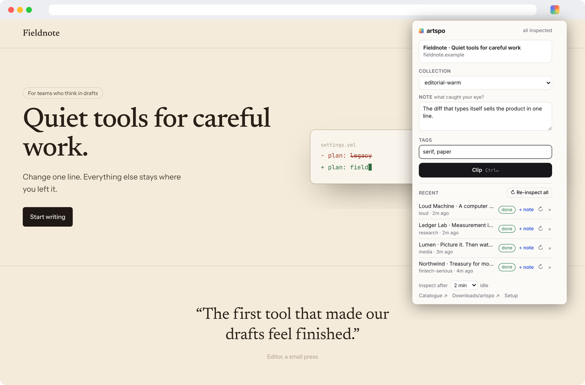
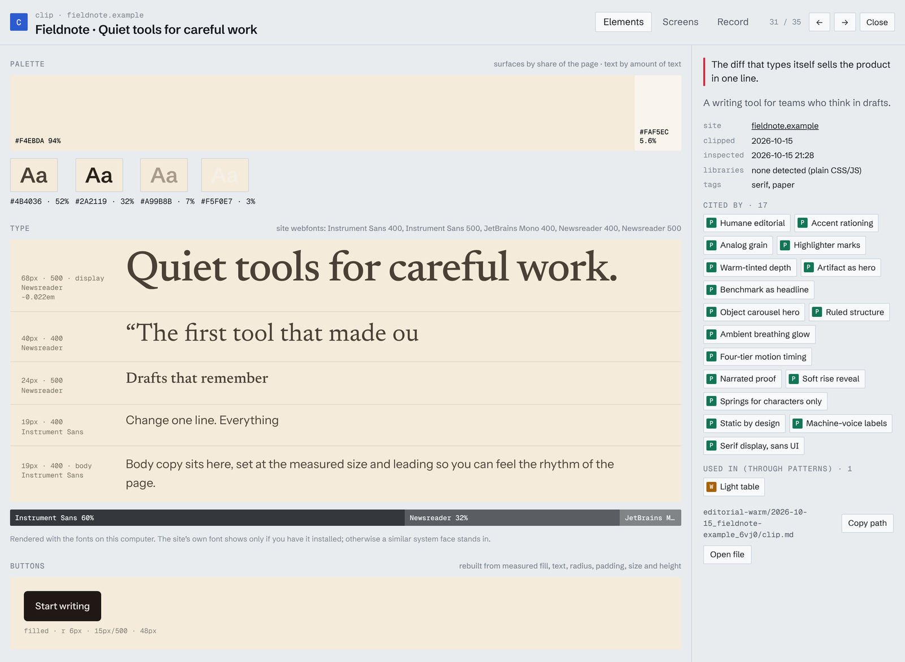
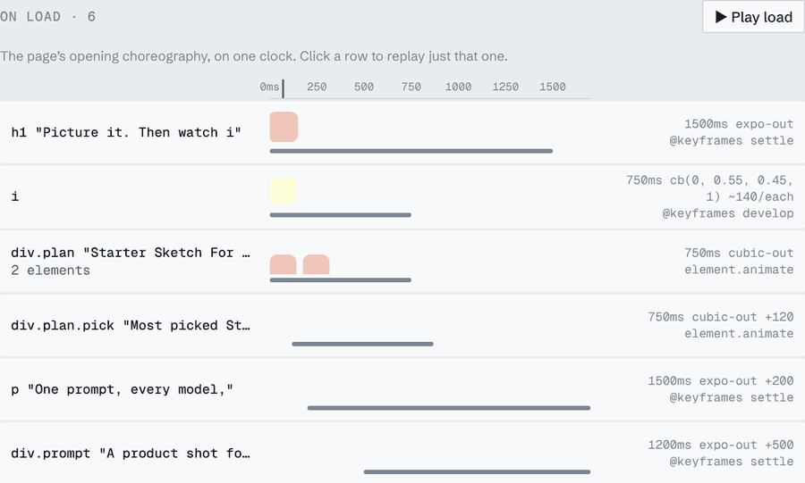
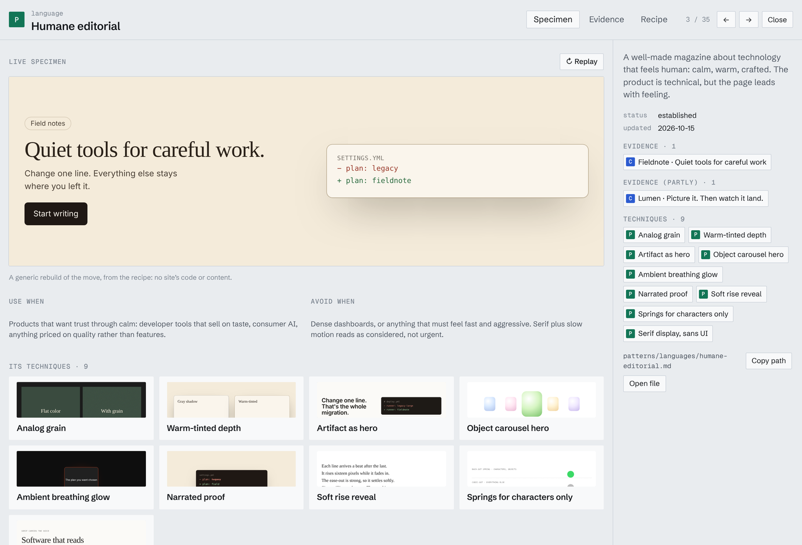
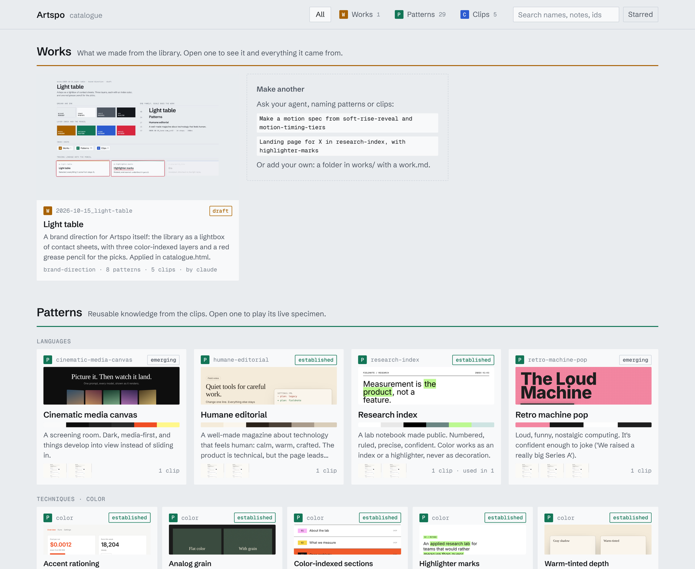
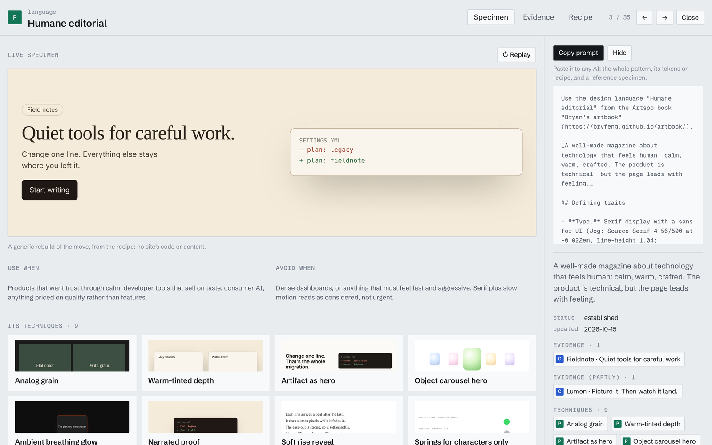
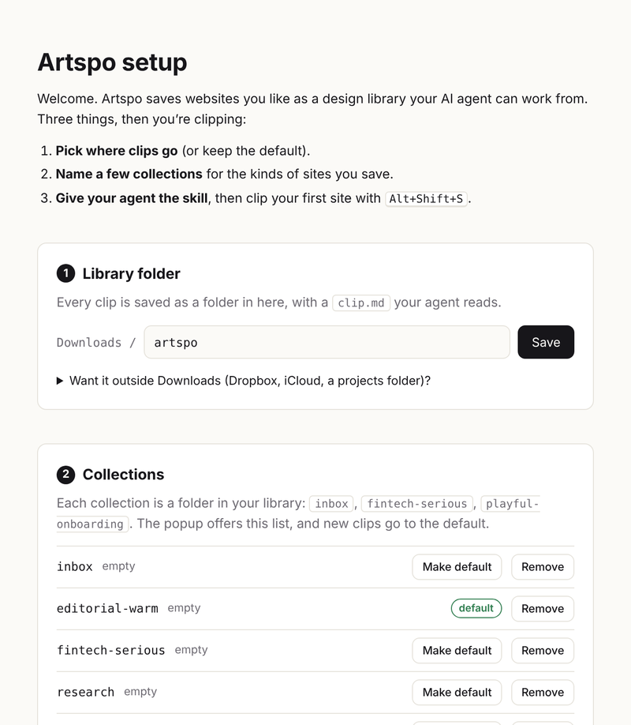

<p align="center"></p>

<h1 align="center">Artspo</h1>

<p align="center"><b>Clip the web's best design. Let your AI agent build from it.</b></p>

<p align="center">
A Chrome extension that measures the sites you save (color, type, shape, and the motion a screenshot misses),<br>
and an agent skill that turns those clips into a design library you can browse, remix and share.
</p>

<p align="center">
<a href="#install">Install</a> · <a href="#for-agents">For agents</a> · <a href="docs/TUTORIAL.md">5-minute tutorial</a> · <a href="LICENSE">MIT</a>
</p>



You find a site you love. Press **Alt+Shift+S**, write one line about what caught your eye, and keep browsing.
While you're away, Artspo opens the page, scrolls it, and records what it's made of. Your agent does the rest.

No server, no account. Everything is plain files in a folder on your computer, readable by any agent:
Claude Code, Codex, Cursor, Gemini CLI, Copilot, or a chat app you upload files to.

<sub>Screens in this README show demo sites built for it, not real companies.</sub>

## Clip

Every clip becomes a folder with a `clip.md`: the palette by share of the page, the type scale, radii, shadows,
buttons, and every animation with its duration, easing, delay and stagger. The catalogue rebuilds each one from
those measurements, so you can see a site's design system at a glance.



## Motion, not just pixels

Screenshots can't show how a page moves, and motion is half of what makes a site feel expensive. Artspo records
the opening choreography and every scroll reveal, then replays them on one clock.



## Distill

Ask your agent to analyze the library. It finds the **design languages** (coherent looks) and **techniques**
(single moves, like a highlighter mark or a staggered rise) your clips share, names them generically, and writes
each as a pattern with a recipe, the evidence behind it, and a **live specimen** you can play.



## Make, and keep track

Ask for a brand direction, a motion spec or a landing page. Each piece lands in `works/` listing the patterns and
clips it came from, and your verdict on it steers the next one. The catalogue puts clips, patterns and works on one
page; click anything to trace it back to the sites behind it.



## Collections are projects

Give a collection a brief ("launch page for a calm writing tool: warm, one quiet accent") and paste in links you
want clipped, without visiting each one. They're inspected while you're idle like any other clip. Your agent reads
the brief before it makes anything for that collection, and works made for it are filed under it.

## Share a book

Publish your library, or one collection, as a **book**: a page anyone can browse, where every pattern and work has a
**Copy prompt** that works in any AI. The same book is one `artbook.md` file, so someone can tell their agent "use
this book as your design reference" with just the link. Other Artspo users can import it and build with your
patterns, credited to you.

Books go on GitHub Pages (or any static host) with a preview card for when the link is posted. They leave out
logged-in pages, your notes, page text, and by default the screenshots of the sites you clipped.
[docs/SHARING.md](docs/SHARING.md) has the steps.



## Install

You need Chrome 118 or newer. Python 3 is optional; agents use it to build the catalogue.

```sh
git clone https://github.com/bryfeng/artspo ~/code/artspo
cd ~/code/artspo && sh install.sh        # gives your coding agents the artspo skill
```

Then open `chrome://extensions`, turn on **Developer mode**, click **Load unpacked**, and choose the `extension`
folder. Pin Artspo to the toolbar. A setup page opens:



Pick where clips go (default `Downloads/artspo`), name a few collections, and you're ready. Reopen it any time
from **Setup** in the popup.

- **Updating:** `git pull`, click ↻ on Artspo in `chrome://extensions`, and run `sh install.sh` again.
- **Library outside Downloads?** Chrome only lets extensions save inside Downloads, so setup gives you a one-line
  command that links a folder there to wherever you want it (Dropbox, iCloud, a projects folder).
- **Moving or reinstalling the extension?** Its memory is tied to its folder, so it starts empty. Your clips are
  safe on disk: in setup, choose **Reconnect a library** and it relearns them.
- **No git?** Use **Code → Download ZIP** on GitHub and unzip it somewhere permanent (not inside your library).

## Use

1. On a site you like, press **Alt+Shift+S**.
2. Write one line about what caught your eye. Your note steers your agent more than any measurement.
3. Pick a collection, add tags if you want, and press **⌘↵** (Ctrl+Enter).

The inspection runs after you've been idle for 2 minutes (adjustable), or now with **Process now**. You'll see a
tab open and close and Chrome's "started debugging this browser" bar; that's how it scrolls the page and records
motion. Clipping the same page again updates its folder, and ↻ re-inspects a clip with the latest Artspo.

Then ask your agent:

> Analyze my artspo library into patterns, then build the catalogue.

> Build a brand direction from my fintech-serious clips. Give me tokens.css and a rationale that names the
> pattern and clips behind each choice.

> Motion spec for a launch page: soft-rise-reveal plus the four-tier timing.

> Make a landing page for my launch-moodboard collection.

> Publish my launch-moodboard collection as a book on GitHub Pages.

> Import https://sam.github.io/artbook/ into my library, then make a pricing page from its patterns and my clips.

## For agents

If you're an agent working with an Artspo library, read the skill first:
[`extension/skills/artspo/SKILL.md`](extension/skills/artspo/SKILL.md). The library also carries a copy as
`AGENTS.md` at its root. The short version:

| Layer | Where | What it is | Who writes it |
|---|---|---|---|
| Clips | `<collection>/<date>_<site>_<id>/clip.md` + `seen.jpg`, `full.jpg`, `filmstrip/` | Evidence: one site, measured, with the user's note | The extension |
| Patterns | `patterns/languages/*.md`, `patterns/techniques/<facet>/*.md`, `patterns/INDEX.md` | Knowledge: languages and techniques, each citing clips, with a recipe and an HTML specimen | You |
| Works | `works/<date>_<name>/work.md` + files | What gets made, listing its patterns and clips; the user's verdict | You, or the user |
| Catalogue | `catalogue.html` | A view of all three | `catalogue.py` |
| Books | a site folder: `index.html` + `artbook.md` | The public edition, with a standalone prompt per pattern and work | `catalogue.py --site`; others' land in `patterns/imported/` via `import_book.py` |

- **Trust in `clip.md`:** the Note is the user's intent and outranks everything. Palette, type, shape, buttons,
  and CSS/WAAPI/GSAP motion lines are measured exactly. Motion "sampled from inline styles" is approximate.
  "Declared transitions" have exact timing and an unknown end state. Never fill in what **Not captured** lists.
- **Rebuild, don't copy.** Recipes and works are generic reconstructions from measurements, never a site's code,
  copy, logos or imagery. Flag font licenses.
- **The user decides.** Never change `starred`, a work's `status` beyond `draft`, or its `## Verdict`.
- **Catalogue:** `python3 extension/skills/artspo/catalogue.py <library>` rebuilds the private page. Add
  `--public --site <dir> --url <address>` for a book, and confirm with the user before publishing anything.
- **Someone else's book:** read its `artbook.md`, or import it with `import_book.py <link>`. Imported patterns
  are `<id>@<book>` and stay read-only.

## More

- [docs/TUTORIAL.md](docs/TUTORIAL.md): five-minute walkthrough
- [docs/INSPECTION.md](docs/INSPECTION.md): what the inspection measures, how, and its limits
- [docs/SHARING.md](docs/SHARING.md): publish a book, use your own domain, import someone else's
- [docs/PRIVACY.md](docs/PRIVACY.md): what Artspo touches and where data goes (nowhere)
- [docs/BACKLOG.md](docs/BACKLOG.md): what's planned
- `sh package.sh` builds the extension zip for a Chrome Web Store upload

## License

MIT. See [LICENSE](LICENSE).
